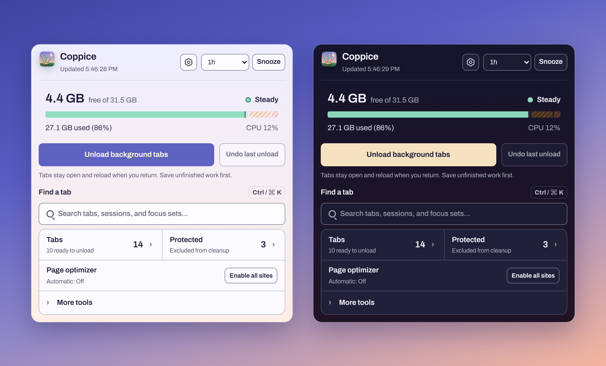
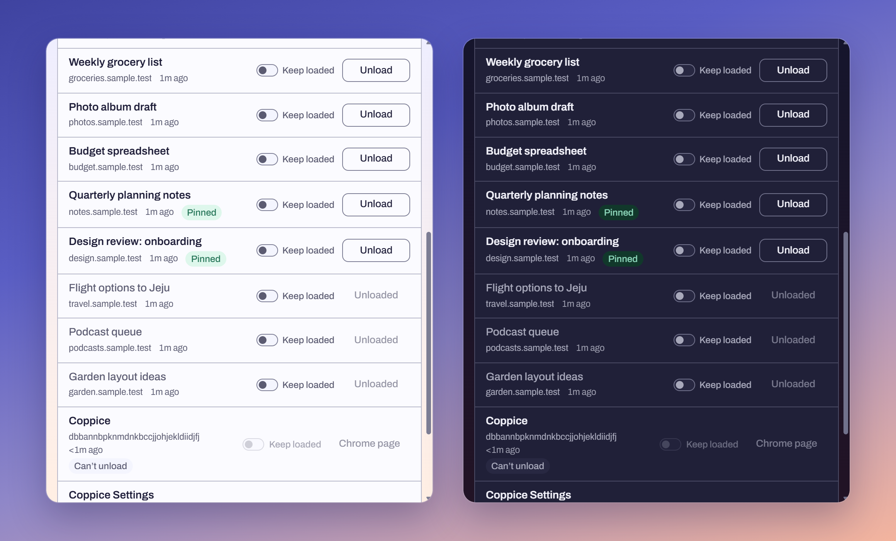
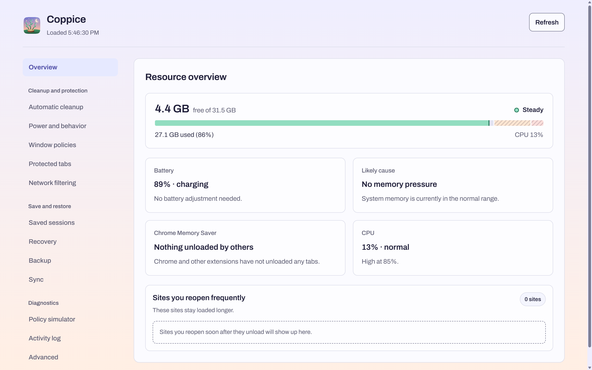

<p align="center">
  
</p>

<h1 align="center">Coppice</h1>

<p align="center">
  <strong>Unload idle tabs. Keep them open.</strong><br />
  A local-first Chrome extension that watches memory, unloads the tabs you aren't using, and brings each one back the moment you return to it.
</p>

<p align="center">
  
  
  
  <a href="LICENSE"></a>
</p>

https://github.com/user-attachments/assets/65381e78-2e29-45a5-a0d0-c685b2a46d7d

<!-- The video above is media/demo.mp4 uploaded to GitHub, which plays only user-attachments videos inline. After re-recording, upload the new file the same way and replace the link. -->

##  Overview

> Coppicing is an old woodland practice: cut a tree back to its stump and it grows again. Coppice does the same for tabs. It unloads the ones you aren't using to free memory, and they come back when you return.

- **See how much memory is left.** The popup shows free memory, pressure and CPU at a glance. The toolbar badge shows **H** when memory runs low, **!** when it is critical, and **Z** while automatic cleanup is snoozed.
- **Free memory in one click.** **Unload background tabs** unloads eligible background tabs within your action limit and reports the change in available system RAM. **Undo last unload** reloads the most recent one.
- **Keep every tab in place.** Unloaded tabs stay in the tab strip with their title and position, and reload when you click them.
- **Let it run on its own.** Choose how soon idle tabs unload, from never to a pressure-adaptive mode that acts only when memory gets tight.
- **Protect what matters.** The tab you are using is never unloaded. Pinned, playing and incognito tabs are protected by default, a detected unsent draft keeps its tab loaded, and you can protect your own sites.
- **Get earlier tabs back.** Saved sessions, recovery capsules and Time Machine snapshots keep recent tab lists within reach.
- **Stay on your computer.** No server and no analytics. Chrome Sync carries only the settings you choose.

Memory release depends on the pages, protection rules and Chrome version. The popup reports system-wide changes, which include other apps, so it cannot attribute all of that change to Coppice.

<p align="center">
  
</p>

##  Installation

Coppice is not in the Chrome Web Store yet. Build it from source:

```bash
git clone https://github.com/crestlux/Coppice.git
cd Coppice
npm ci
npm run build
```

1. Open `chrome://extensions`.
2. Turn on **Developer mode** in the top-right corner.
3. Choose **Load unpacked** and select the `dist` folder.
4. Pin Coppice to the toolbar so the memory badge stays visible.

Requires Chrome 132 or later and Node.js 22.12+, 24 or 26+.

##  Quick Start

1. **Open the popup.** The gauge shows free memory. The two notches mark where High and Emergency begin, and the label beside it reads Steady, Watch, High, Emergency or Recovering.
2. **Unload now.** Choose **Unload background tabs**. The result appears at the bottom, for example *Unloaded 8 tabs. Available system RAM +650 MB.* Save unfinished work first, because pages reload when you return.
3. **Choose how Coppice cleans up on its own.** Open the gear button, then **Automatic cleanup**. Balanced, the default, unloads tabs idle for 15 minutes. Pick **Manual only** if you want to start every unload yourself.
4. **Let Coppice check for unsent drafts.** This step is optional. In **Automatic cleanup**, choose **Allow website checks**. With website access, Coppice can tell when a page holds text you typed and haven't sent, and keeps that tab loaded. Granting it does not turn on Page optimizer.
5. **Protect your sites.** In the popup, open **More tools** and choose **Protect this site**. You can also turn on **Keep loaded** for a single tab in the Tabs list, or add rules under **Protected tabs** in Settings.
6. **Find any tab.** Press `Ctrl` + `K` (`⌘` + `K` on Mac) in the popup to search open tabs, saved sessions and Focus sets.

Need a quiet hour? **Snooze** pauses automatic cleanup for the time you pick. Manual actions keep working.

##  Features

### The popup

| Part | What it does |
| --- | --- |
| Memory gauge | Free memory against total RAM, with CPU. Click it for Resource details and per-tab measurements. |
| **Unload background tabs** | Unloads eligible background tabs within your action limit, then reports the change in available system RAM. |
| **Undo last unload** | Reloads the most recent tab Coppice unloaded, as long as it is still open. |
| **Find a tab** | Searches open tabs, saved sessions and Focus sets as you type. |
| **Tabs** | Every open tab with its site and when you last used it. Unload or keep a single tab, use Focus mode, or open **Unload options** to unload by site, unload tabs idle longer than N minutes, or set a per-site rule. |
| **Protected** | The tabs Coppice will leave alone, and why. |
| **Page optimizer** | Its current mode, with one-click access to turn it on. |
| **More tools** | Unloaded and frozen tabs, cleanup and network modes, **Find duplicate tabs**, **Close unloaded tabs**, **Protect this tab** or **Protect this site**, and **Save window and close**. |

**Find duplicate tabs** shows each set of duplicates and which copy it keeps before closing the rest. Coppice can also switch you to a page that is already open instead of opening it twice.

<p align="center">
  
</p>

### Automatic cleanup

| Mode | Unloads tabs idle for | Best for |
| --- | ---: | --- |
| Manual only | Never on its own | Starting every unload yourself |
| Conservative | 30 minutes | Keeping more tabs ready |
| Balanced | 15 minutes | Everyday use (default) |
| Aggressive | 5 minutes | Tight memory |
| Pressure adaptive | 2–45 minutes | Waiting until memory gets tight, then acting sooner as it tightens |
| Custom | Your choice | A fixed time you set |

Each window and each site can follow its own rule. On battery, Coppice can unload sooner and work in smaller batches. Tabs you reopen right after an unload stay loaded longer next time, and Coppice never adds a protection rule without asking.

### Protection

- **Always protected:** the tab you are using.
- **Protected by default:** pinned tabs, tabs playing audio, incognito tabs, and pages that ask Chrome not to unload them.
- **Your rules:** protect a site or a URL pattern, or switch on **Keep loaded** for one tab until it closes.
- **Focus mode:** keep the tabs you choose and unload the rest sooner. Save a selection as a Focus set to reuse it.
- **Unsent drafts:** **Protect unsaved work** is on by default. On sites you allow, Coppice notices text you typed and haven't sent, including after you move to another field, and keeps that tab loaded:
  - A detected draft is never unloaded, not even when you ask.
  - Routine cleanup skips pages Coppice can't check.
  - Pages Coppice can't check are unloaded only when you ask or when memory runs low, and Coppice never closes them.
  - Typed text is never stored or sent anywhere.

### Recovery, sessions and backup

- **Saved sessions:** save a window, a tab group or a selection and close it, then restore it later with pins and groups intact. Tabs that are protected or changed in the meantime stay open, and the result shows both counts.
- **Recovery capsules:** saved automatically before Coppice closes tabs.
- **Time Machine:** periodic snapshots of your open tabs, restorable in place or in a new window.
- **Session trash:** deleted sessions wait here until you restore or remove them.
- **Backup:** export everything, or only the parts you pick, as versioned JSON. Import by merging or replacing.
- **Sync:** settings, protection rules and Focus sets can travel through Chrome Sync. Sessions, logs and recovery history stay on this device.

### Honest memory numbers

- The gauge shows system memory, which includes every app on your computer, not only Chrome.
- After each unload, the result line shows the change in available system RAM, first after about 2 seconds and again after about 15 seconds as Chrome hands memory back. Other apps affect this reading too.
- Every unload is checked against Chrome's own tab state. **Unloaded tabs** in More tools lists what happened and why any tab stayed loaded.
- **Policy simulator** in Settings previews which tabs a mode would unload, without changing anything.
- **Measure tab memory** reads JavaScript memory and CPU for the tabs you choose. Chrome shows its debugging bar while it runs, and JavaScript memory is only part of a tab's total footprint.

### Network filtering

Off by default. Light mode blocks a short list of background trackers: third-party pings, Google Analytics, Google Tag Manager and DoubleClick. Low battery can turn Light mode on for a while. A few sites may behave differently, so turn it on when you need it.

### Page optimizer (beta)

Reduces rendering work for eligible distant content and older parts of long AI conversations, and pauses eligible offscreen animations and silent autoplay videos. Turn it on for one tab, for saved sites, or for all sites after Chrome asks for website access. **Pause on this tab** and **Exclude site** undo it in one click. Benefits depend on the page; broad speedups have not been established.

### Settings

<p align="center">
  
</p>

| Section | What you can do there |
| --- | --- |
| Overview | Memory, battery, CPU, the likely cause of pressure, and unloads by Chrome or other extensions |
| Automatic cleanup | Cleanup mode, protections, unsaved-work checks, batch limits and the memory levels for High and Emergency |
| Power and behavior | Battery policy, how long reopened tabs stay loaded, Time Machine snapshots, and switching to an open tab instead of opening a duplicate |
| Window policies | A different cleanup mode for a single window |
| Protected tabs | Site and URL-pattern rules |
| Network filtering | Off or Light |
| Saved sessions | Save, restore and manage sessions and the session trash |
| Recovery | Recovery capsules and Time Machine snapshots |
| Backup | Export everything or chosen parts, then import by merging or replacing |
| Sync | Choose what travels through Chrome Sync, then upload or download |
| Policy simulator | Preview what a mode would unload right now |
| Activity log | Every unload and undo, copyable as JSON |
| Advanced | How much history to keep, the high-CPU level, the toolbar badge, and privacy mode for the activity log |

##  How Coppice Stays Safe

- **Protect first.** Active and protected tabs are excluded before anything else is considered.
- **Small batches.** Automatic and manual unloads both have limits you can set.
- **Check again before acting.** A tab that became active, changed or became protected a moment ago is skipped.
- **Verify the result.** Chrome's actual tab state is read after every unload.
- **Back off when unsure.** If it is unclear that Chrome is the cause of the pressure, Coppice unloads at most one tab and waits to see the effect.
- **Never chase a number.** Critical pressure does not start an "unload until memory is free" loop, which could set off waves of reloads.

##  Privacy and Data Handling

- No remote server, analytics or tracking code.
- Settings and records stay in your Chrome profile (`chrome.storage.local` and `chrome.storage.session`).
- Tab titles and URLs are stored locally only where a feature needs them, such as saved sessions and protection rules.
- Unsaved-work checks run inside the page on sites you allow. They keep only short-lived signals that something was edited, never the text itself.
- Privacy mode removes titles and URLs from the activity log and its backup metadata. Saved sessions, rules and recovery records still need their URLs.
- Chrome Sync is used only after you turn it on and choose what to sync.

##  Permissions

| Permission | Why Coppice needs it |
| --- | --- |
| `tabs`, `tabGroups` | Read, unload, close and restore tabs and groups |
| `storage` | Keep settings, sessions and records, and sync the parts you choose |
| `alarms`, `idle` | Check memory on a schedule and notice when Chrome is idle |
| `system.memory`, `system.cpu` | Measure system memory and CPU |
| `offscreen` | Read battery status where Chrome supports it |
| `declarativeNetRequest` | Network filtering rules |
| `activeTab`, `scripting` | Page optimizer and unsaved-work checks on the tabs and sites you allow |
| `debugger` | **Measure tab memory** and memory sorting you enable, including refreshes when reopening the popup; Chrome may show a debugging bar |
| Optional `http://*/*`, `https://*/*` | Unsaved-work checks and Page optimizer on websites you allow |

Website access is optional and not granted by default. **Allow website checks** grants it for unsaved-work checks without turning on Page optimizer, which has its own switch. You can revoke access at any time in Chrome's extension settings.

##  Known Limitations and Cautions

- Unloaded pages reload when you return. Work protection can miss drafts in editors that draw on a canvas or keep text outside the page, and it can't tell whether a site saved your work on its server. Edits made before monitoring started may not be detected. Keep critical work saved, or protect its tab or site.
- Work protection covers Coppice's own unload and close actions, not Chrome's Memory Saver or another extension.
- Memory figures are system-wide changes, not exact per-tab numbers, and the operating system can take a few seconds to hand memory back.
- Coppice can see that Chrome or another extension unloaded a tab, but not which one did.
- Chrome's own pages and some special URLs can't be unloaded, measured or restored.

##  Development

```bash
npm run typecheck      # TypeScript checks
npm run build          # Development build into dist/
npm run build:release  # Store build without source maps
```

GitHub Actions checks installation, types and the release build on Windows and Linux. The maintainer's `tests/`, `scripts/`, browser configuration and raw experiments are excluded from this public source snapshot; the related npm commands require that local tooling and are not part of the public CI checks.

For the Chrome Web Store, zip the **contents** of `dist/` after `npm run build:release`, with `manifest.json` at the root of the archive.

```text
icons/            Extension icons and their SVG sources
media/            README images, demo video and section icons
src/background/   Cleanup policy, scanning, recovery, optimizer and sync
src/content/      Local unsaved-work tracking on sites you allow
src/popup/        Toolbar popup
src/options/      Settings page
src/shared/       Shared types, storage, design tokens and the memory gauge
src/offscreen/    Battery status bridge
```

##  Contributing

Bug reports are welcome. Please include your Chrome version, the cleanup mode, steps to reproduce and any error message. Before opening a pull request, make sure `npm run typecheck` and `npm run build:release` pass. Use sample pages and remove private URLs, tab titles, drafts and credentials from screenshots or logs.

##  License

Coppice's source code is released under the [MIT License](LICENSE).

The license does not cover the Coppice name or icon (the artwork in `icons/`). Please don't use them for another extension, app or fork; give your version its own name and icon.

The bundled Archivo font keeps its own SIL Open Font License; see [THIRD_PARTY_NOTICES.md](THIRD_PARTY_NOTICES.md).
